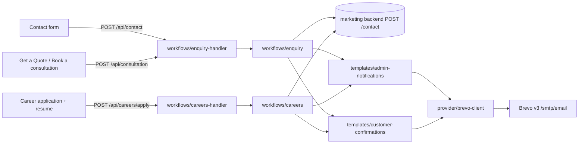

# VPD Technologies transactional email integration

Everything the website sends by email, and how to run, test and deploy it.

## What sends email

The Next.js app in this repository is the sender. Each public form posts to a
route handler under `app/api/`, and that handler runs the whole pipeline on the
server: validate → spam/rate guard → durable store → admin notification →
submitter confirmation. Brevo is called with `fetch` from
`src/lib/email/provider/brevo-client.ts`, which only route handlers import, so
the API key never reaches a client bundle.

The **durable store is not this app**: submissions are persisted by POSTing to
the existing marketing backend (`${NEXT_PUBLIC_API_URL}/contact`, default
`https://vpd-technologies-pvt-ltd-backend.vercel.app/api`). That backend does not
send mail, and mail was deliberately not moved into it — it has no local source
in this workspace, and the working Brevo flow lives here.



## Four forms, three code paths

"Get a Quote" and "Book a consultation" are the same workflow: the navbar's
Get a Quote button opens the consultation modal (`Navbar.tsx` →
`ConsultationContext` → `ConsultationModal.tsx`), which posts to
`/api/consultation`. The admin copy therefore carries the quotation subject and
the visitor copy stays the consultation acknowledgement.

| Form | Route | Pipeline | Emails per submission |
|---|---|---|---|
| Contact | `/api/contact` | `workflows/enquiry.ts` (`kind: 'contact'`) | 1 admin + 1 visitor |
| Get a Quote / Book consultation | `/api/consultation` | `workflows/enquiry.ts` (`kind: 'consultation'`) | 1 admin + 1 visitor |
| Career application | `/api/careers/apply` | `workflows/careers.ts` | 1 recruiter (resume attached) + 1 applicant |

## Where the details are documented

- [folder-structure.md](folder-structure.md) — every file and why it sits where it does
- [environment-variables.md](environment-variables.md) — the five variables, and where they must be set
- [email-workflows.md](email-workflows.md) — subjects, From/To/Reply-To, limits, attachment rules
- [deployment-checklist.md](deployment-checklist.md) — numbered go-live runbook
- [troubleshooting.md](troubleshooting.md) — what to check when a mail does not arrive

## Commands

```bash
npm run lint          # tsc --noEmit, the repository's type gate
npm test              # vitest run, Brevo and the backend are always mocked
node scripts/check-email-logo-url.mjs           # proves the logo URL is publicly reachable
node --env-file=.env scripts/check-email-sender.mjs  # is the sender believed by receiving servers?
node scripts/generate-email-logo.mjs            # rebuilds assets/logo-asset.ts from public/logo.png
NEXT_DIST_DIR=.next-build npx next build        # production build beside a running dev server
```

## Non-negotiables

- `BREVO_API_KEY` is server-only. It never goes in a `NEXT_PUBLIC_*` variable, a
  log line, an error response, a test fixture or a tracked file. `.env.example`
  documents names with empty values only.
- The Brevo `sender.email` is always a sender verified in the Brevo account. A
  visitor's or applicant's address is only ever a recipient or a validated
  Reply-To — never the sender.
- Customer-facing confirmation templates are a separate file from the internal
  notifications, and their wording acknowledges receipt only: no scope, price,
  appointment, interview or offer is implied.
